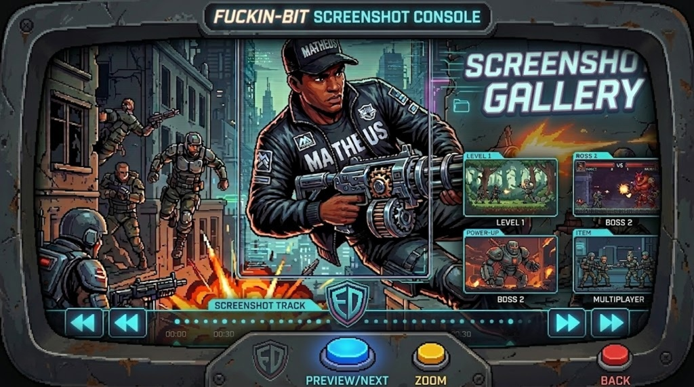
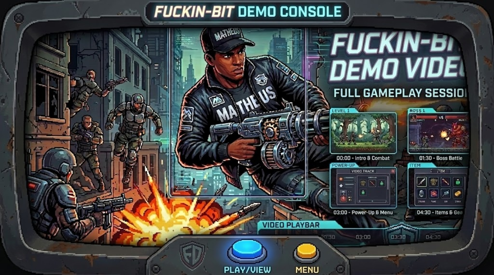

# 👾 Fuckin-Bit

A pixel-art arcade-inspired *Shoot 'em up* game developed as a Minimum Viable Product (MVP) for internal training at Commit Jr. The core gameplay challenges players to navigate intense stages, dodging hazards and obliterating waves of oncoming enemies to successfully clear each level.

---

## 👥 Authorship

* **Developer:** Matheus Ferreira
* **Organization:** Commit Jr.
* **Release Date:** May 14, 2021

---

## 🎯 Core Features & Gameplay Mechanics

* **Classic Shoot 'em up Action:** Fast-paced retro combat mechanics focused on positioning, dodging, and precise shooting.
* **Stage Progression:** Scale through distinct enemy waves and layout challenges designed to test player reflexes.
* **Retro Pixel Art Style:** Immersive 8-bit/16-bit inspired visual aesthetic crafted to mimic old-school arcade cabinets.
* **Enemy Variety:** Multiple combat units distributed across the map with unique spacing and engagement behaviors.

---

## 🛠️ Tech Stack & Architecture

The project was built leveraging lightweight development structures optimized for 2D game loops, asset handling, and performance training during the Commit Jr. onboarding cycle.

---

## 📸 Media Gallery

  
  

